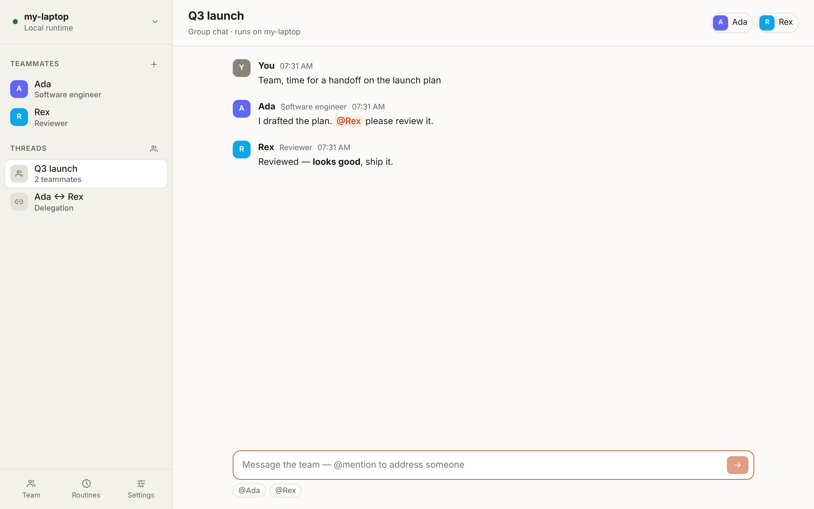

# Crew

AI teammates that do real work on a computer — yours, or a remote VM — using any model provider.



## How it fits together

```
┌─ Desktop app (Electron) ─┐        ┌─ Remote VM ───────────────┐
│  UI ── local runtime     │──HTTP──│  runtime (same single file) │
│        (child process)   │  +SSE  │  bots · workspaces · cron   │
└──────────────────────────┘        └────────────────────────────┘
```

One **runtime** (`dist/crew-runtime.mjs`, a single dependency-free Node file) owns everything a bot
needs: the agent loop, tools, workspaces, memory, routines and the HTTP/SSE API. The desktop app
starts one locally and can connect to any number of remote ones. A bot lives on exactly one runtime;
"local vs. remote" is just which runtime you create it on (or copy it to).

| Feature | What it does |
|---|---|
| Teammates | Named bots with a role, instructions, model, autonomy level and capabilities. Templates included. |
| Own computer | Terminal, workspace files, web fetch, optional headless browser (Playwright). |
| Local or remote | Built-in local runtime; connect remote VMs from Settings; switch in the top-left menu; copy a bot across. |
| Any model | OpenAI-compatible (xAI/Grok, OpenAI, OpenRouter, Ollama, LM Studio, vLLM, gateways) or Anthropic-compatible. Per-bot provider + model. Keys stay on the runtime. |
| Teamwork | Group chats with a lead and `@mention` hand-offs; `ask_teammate` delegation from any chat (visible as its own thread). |
| Routines | Saved prompts run on a cron schedule or on demand; bots can save routines themselves. |
| Memory | Per-bot `MEMORY.md` (written by the bot, editable by you) plus a shared, read-mostly `TEAM.md` per runtime that every bot reads. Only bots marked "Team memory writer" can append to it. |
| Long threads & long tasks | Past a context budget (Settings → Context, default 32k tokens, estimated) older messages fold into a rolling thread summary, and older *steps of a running task* fold into a summary the bot writes itself. If that summary fails, old tool outputs are cleared instead. The full history stays visible in the UI. |
| Prompt caching | Prompts are built to be byte-stable across a run: a two-part system prompt (stable first, memory/summary second), no clock time, a fixed tool order. Anthropic-format providers get explicit `cache_control` breakpoints; OpenAI-compatible providers rely on their automatic prefix caching. Token usage, including cache hits, is shown on each reply. |
| Images | `read_file` on a PNG/JPEG/GIF/WebP, browser screenshots and MCP image results are shown to the model during the run that produced them. Models that reject images get the request retried without them, and are remembered. |
| Isolation | Per bot: **Own container** (Docker or Podman; only that bot's workspace is mounted) or **Host**. New bots default to a container when an engine is running. |
| Connectors | Stdio MCP servers configured per runtime. |
| Controls | Ask-first / Autonomous / Read-only per bot, inline approvals, Stop. |

### Container isolation

Each isolated bot gets one long-lived container named `crew-<bot id>` with its workspace at
`/workspace`. Shell commands run there; timeouts and Stop kill the whole process tree inside it.
Settings → Containers sets the image (default `node:22-bookworm`), network access and whether to run
as root. If no engine is running, an isolated bot's commands **fail** rather than fall back to the host.

What the container does *not* cover: file tools, web fetch, the browser tool and MCP servers still run
in the runtime process on the host. File tools are confined to the workspace (symlinks included), but
a bot with "Connectors" enabled can do whatever those MCP servers allow. Containers share the host
kernel — this is strong separation between bots and from your files, not a defence against a
kernel exploit. For that, put the runtime on a dedicated VM.

## Run it

```bash
npm install
npm run build
npm start            # runtime + UI in your browser: open the printed link
npm run desktop      # or the Electron app (npm i -D electron first)
```

## Put a runtime on a VM

Copy `dist/` to the VM (Node 20+), then:

```bash
node crew-runtime.mjs --name build-vm          # binds 127.0.0.1:4780, prints an "Open:" link with the token
ssh -N -L 4781:127.0.0.1:4780 user@vm          # on your machine
```

In the app: **Settings → Connect remote** and paste `http://127.0.0.1:4781/#token=…`.
`deploy/` has a systemd unit and a Dockerfile. The runtime speaks plain HTTP: use an SSH tunnel, VPN
or a TLS reverse proxy — don't expose `--host 0.0.0.0` to the internet.

## Tests

```bash
npm test                 # runtime end-to-end against a scripted provider (container tests run when Docker is available)
npm run test:ui          # drives the real UI in Chromium across two runtimes (needs playwright)
npm run test:desktop     # launches the Electron shell
node test/mock-provider.mjs 4999   # a fake provider at http://127.0.0.1:4999/v1 for clicking around
```

## Known limits

- **Host bots are not sandboxed.** A bot set to "Host" runs shell commands as the runtime's OS user.
  Use "Ask first", or prefer a container or VM.
- **Single user.** One access token per runtime; no accounts, roles or audit log.
- **Team memory is per runtime** and not synced between your laptop and a VM.
- **Context size is estimated** (about 4 characters per token, a flat ~1,600 tokens per image), not
  counted. Measured usage is reported in the UI but does not drive compaction.
- **Images are kept only for the run that produced them.** Later turns see a file path and can
  re-open it with `read_file`.
- **Prompt caching with Anthropic uses the default 5-minute TTL.** A reply after a longer pause
  rewrites the cache once. Whether a provider caches at all is up to the provider.
- **Not built:** Slack/Teams presence, joining meetings, learning a routine by watching your screen,
  OAuth-style app connectors (MCP only), mobile app.
- **Untested:** installers (`npm run dist`), the default container image and non-root container mode
  (tests use `debian:bookworm-slim` as root), Podman, the Dockerfile and systemd unit.
